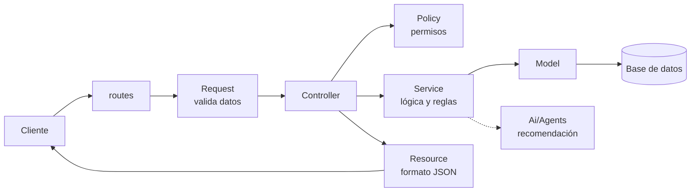

# Arquitectura Laravel - Cloud_con_IA

En este documento explicamos cómo vamos a organizar el código de la aplicación en Laravel.

La idea principal del proyecto es que la IA recomienda, pero quien decide es Laravel.

El resto del análisis está en estos documentos:

- [modulos.md](modulos.md): mapa funcional y módulos de la aplicación.
- [dominio-cloud.md](dominio-cloud.md): catálogo, proveedores y regiones, proyectos y requerimientos.
- [modelo-datos.md](modelo-datos.md): entidades, relaciones y diagrama E-R.
- [ia.md](ia.md): uso de la Inteligencia Artificial y riesgos.

---------------------------------------------------------------------------------------------------------------------------------

## 1. Función de cada parte de Laravel

En la UT1 no vamos a crear todavía toda esta estructura, pero sí tenemos que saber para qué sirve cada parte y qué vamos a poner en cada una.

| Parte | Para qué sirve | Ejemplo en nuestro proyecto |
|---|---|---|
| routes/ | Define las URL de la aplicación y qué se ejecuta en cada una | “POST /api/proyectos” para crear un proyecto |
| Controllers/ | Recibe la petición, llama a quien tiene que hacer el trabajo y devuelve la respuesta | ProyectoController, PresupuestoController |
| Requests/ | Valida los datos que llegan antes de que entren al controlador | CrearProyectoRequest comprueba que el presupuesto sea un número mayor que 0 |
| Services/ | Aquí va la lógica de negocio: cálculos, reglas y comprobaciones | PresupuestoService calcula subtotal, impuestos y total |
| Models/ | Representan las tablas de la base de datos y sus relaciones | Proyecto, Producto, Pedido |
| Resources/ | Dan formato a los datos que devuelve la API en JSON | ProyectoResource decide qué campos del proyecto se envían |
| Enums/ | Guardan listas de valores fijos | TipoProducto (COMPUTACIÓN, BACKUP...), EstadoPedido (pendiente, pagado...) |
| Policies/ (más adelante) | Comprueban si un usuario tiene permiso para hacer algo | Un cliente solo puede ver sus propios proyectos |
| Ai/Agents/ (más adelante) | Se encargan de hablar con la IA | Pedir a la IA una recomendación de arquitectura |

## 2. Separación de responsabilidades

Si ponemos toda la lógica en los controladores, al final tendríamos controladores enormes, difíciles de leer y con el mismo código repetido en varios sitios. Por ejemplo, el cálculo del precio se necesita en el carrito, en el presupuesto y en el pedido. Si está en cada controlador, cuando cambie el IVA habría que cambiarlo en tres sitios.

Por eso cada parte se encarga de una cosa:

- Los Requests validan los datos de entrada.
- Los Controllers solo reciben la petición y devuelven la respuesta.
- Los Services tienen la lógica (precios, reglas, comprobar requerimientos).
- Los Models acceden a la base de datos.
- Los Resources dan formato a la respuesta.

Así el código se puede reutilizar, es más fácil de probar y si algo falla sabemos dónde mirar.

Esto también es importante para la IA. La llamada a la IA va en su propia parte (Ai/Agents) y lo que devuelve pasa siempre por un Service de Laravel que comprueba que los productos existen, que los precios son los del catálogo y que se cumplen los requerimientos. La IA nunca guarda nada directamente en la base de datos.

## 3. Diagrama de la arquitectura

Este es el camino que sigue una petición, por ejemplo cuando el cliente pide un presupuesto:

La flecha de puntos hacia la IA es porque solo se usa en algunos casos, por ejemplo al pedir una recomendación, y lo que devuelve lo revisa siempre el Service antes de guardar nada.
