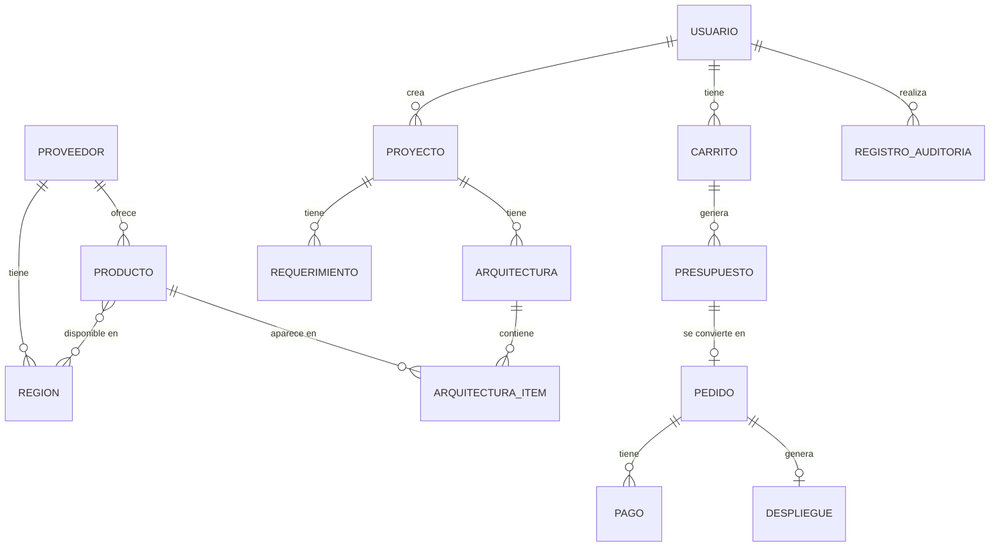

# Modelo conceptual de datos - Cloud_con_IA

En este documento están las entidades principales de la aplicación y cómo se relacionan. Las hemos sacado de los casos de uso. Es un modelo inicial y lo cambiaremos en la UT2 cuando hagamos las migraciones.

## 1. Entidades

| Entidad | Para qué sirve | Datos principales |
|---|---|---|
| Usuario | Personas que usan la aplicación | Nombre, email, contraseña y rol |
| Proveedor | Empresa que ofrece los productos | Nombre y país |
| Región | Dónde tiene servidores el proveedor | Nombre y zona (EU, US, Asia) |
| Producto | Productos del catálogo | Código, nombre, tipo, precio y estado |
| Proyecto | Lo que quiere el cliente | Nombre, descripción y presupuesto máximo |
| Requerimiento | Condiciones del proyecto | Atributo, operador, valor y si es obligatorio |
| Arquitectura | Propuesta para un proyecto | Estado y si viene de la IA o es manual |
| ArquitecturaItem | Cada producto de una arquitectura | Producto, región, cantidad y configuración |
| Carrito | Lo que se va a contratar | Cliente y productos |
| Presupuesto | Precio final antes de pagar | Fecha, caducidad, subtotal, impuestos y total |
| Pedido | Lo que contrata el cliente | Estado y fecha |
| Pago | Pago simulado | Importe, estado y fecha |
| Despliegue | Puesta en marcha simulada | Estado y recursos creados |
| RegistroAuditoría | Acciones importantes | Usuario, acción y fecha |

Algunas cosas a tener en cuenta:

- El rol (CLIENTE, ARQUITECTO, AUDITOR o ADMINISTRADOR) va en la tabla de usuarios.
- Los requerimientos se guardan separados. Por ejemplo, “ram >= 8” se guarda como atributo “ram”, operador “>=” y valor “8”.
- El presupuesto guarda los precios del momento, así si cambia un precio después, el presupuesto no cambia.

## 2. Relaciones

| Entidad A | Entidad B | Cardinalidad |
|---|---|---|
| Proveedor | Región | 1:N |
| Proveedor | Producto | 1:N |
| Producto | Región | N:M |
| Usuario | Proyecto | 1:N |
| Proyecto | Requerimiento | 1:N |
| Proyecto | Arquitectura | 1:N |
| Arquitectura | ArquitecturaItem | 1:N |
| Producto | ArquitecturaItem | 1:N |
| Usuario | Carrito | 1:N |
| Carrito | Presupuesto | 1:N |
| Presupuesto | Pedido | 1:1 |
| Pedido | Pago | 1:N |
| Pedido | Despliegue | 1:1 |
| Usuario | RegistroAuditoría | 1:N |

## 3. Diagrama

## 4. Cosas por decidir

- Si los datos específicos de cada producto van en una tabla por tipo o en un JSON.
- Si un usuario puede tener más de un rol.

Lo veremos en la UT2.
