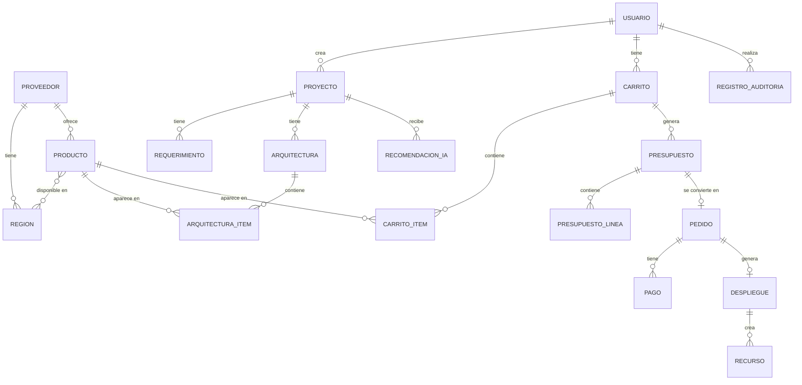

# Modelo conceptual de datos - Cloud_con_IA

En este documento vamos a definir las entidades principales de la aplicación, qué datos guarda cada una y cómo se relacionan entre ellas. Para sacarlas nos hemos basado en los actores y en los 12 casos de uso del proyecto, mirando qué información necesita cada caso de uso para funcionar.

Es un modelo inicial, así que en la UT2, cuando empecemos a crear las migraciones en Laravel, seguramente cambiará.

## 1. Entidades

| Entidad | Para qué sirve | Datos principales |
|---|---|---|
| Usuario | Guarda las personas que usan la plataforma | Nombre, email, contraseña (cifrada) y rol |
| Proveedor | Empresa que ofrece los productos Cloud | Nombre, país y web |
| Región | Zona donde un proveedor tiene sus servidores | Nombre, código, zona (EU, US o Asia) y proveedor |
| Producto | Cada producto del catálogo | Código, nombre, descripción, tipo, precio, forma de pago, estado y proveedor |
| Proyecto | Lo que quiere conseguir el cliente | Nombre, descripción, presupuesto máximo, usuarios esperados, nivel de seguridad y cliente |
| Requerimiento | Cada condición técnica de un proyecto | Atributo, operador, valor, si es obligatorio u opcional y de dónde viene |
| Arquitectura | Propuesta de infraestructura para un proyecto | Proyecto, estado, origen (IA o manual) y coste mensual estimado |
| ArquitecturaItem | Cada producto que forma parte de una arquitectura | Arquitectura, producto, región, cantidad y configuración elegida |
| RecomendaciónIA | Guarda lo que ha propuesto la IA | Proyecto, datos enviados, respuesta, fecha y si se ha aceptado |
| Carrito | Productos que el cliente va a contratar | Cliente, estado y fecha |
| CarritoItem | Cada línea del carrito | Carrito, producto, configuración, cantidad, precio mensual y precio único |
| Presupuesto | Documento con el precio final antes de pagar | Carrito, fecha de creación, fecha de caducidad, subtotal, impuestos, total y estado |
| PresupuestoLínea | Copia de cada línea del carrito en el momento del presupuesto | Presupuesto, producto, configuración, cantidad y precio |
| Pedido | Contratación que hace el cliente al aceptar un presupuesto | Presupuesto, cliente, estado y fecha |
| Pago | Pago simulado de un pedido | Pedido, importe, estado, fecha y referencia |
| Despliegue | Puesta en marcha simulada de un pedido | Pedido, estado y fechas de inicio y fin |
| Recurso | Cada elemento creado en un despliegue | Despliegue, producto, nombre, configuración y estado |
| RegistroAuditoría | Guarda las acciones importantes | Usuario, acción, entidad afectada, fecha y detalles |

Algunas cosas a tener en cuenta:

- El rol del usuario (CLIENTE, ARQUITECTO, AUDITOR o ADMINISTRADOR) lo guardamos en la propia tabla de usuarios, porque de momento cada usuario tiene un solo rol.
- Los requerimientos no se guardan como texto, sino separados en atributo, operador y valor. Por ejemplo, “ram >= 8” se guarda como atributo “ram”, operador “>=” y valor “8”. Así Laravel y la IA pueden leerlos y comprobarlos.
- El presupuesto guarda una copia de los precios en “PresupuestoLínea”. Si el administrador cambia el precio de un producto después, el presupuesto que ya se hizo no cambia.
- Los estados (de la arquitectura, del pedido, del pago, etc.) serán Enums en Laravel.

## 2. Relaciones

| Entidad A | Relación | Entidad B | Cardinalidad |
|---|---|---|---|
| Proveedor | tiene | Región | 1:N. Un proveedor tiene varias regiones y cada región es de un proveedor |
| Proveedor | ofrece | Producto | 1:N. Un proveedor ofrece muchos productos |
| Producto | está disponible en | Región | N:M. Un producto puede estar en varias regiones y en una región hay muchos productos |
| Usuario | crea | Proyecto | 1:N. Un cliente puede tener varios proyectos |
| Proyecto | tiene | Requerimiento | 1:N. Un proyecto tiene varios requerimientos |
| Proyecto | tiene | Arquitectura | 1:N. Un proyecto puede tener varias propuestas de arquitectura |
| Proyecto | recibe | RecomendaciónIA | 1:N. Se puede pedir recomendación a la IA varias veces |
| Arquitectura | contiene | ArquitecturaItem | 1:N |
| Producto | aparece en | ArquitecturaItem | 1:N. El mismo producto puede estar en muchas arquitecturas |
| Usuario | tiene | Carrito | 1:N |
| Carrito | contiene | CarritoItem | 1:N |
| Carrito | genera | Presupuesto | 1:N. Si un presupuesto caduca se puede generar otro |
| Presupuesto | contiene | PresupuestoLínea | 1:N |
| Presupuesto | se convierte en | Pedido | 1:1. Cada presupuesto aceptado genera un pedido |
| Pedido | tiene | Pago | 1:N. Si un pago falla se puede volver a intentar |
| Pedido | genera | Despliegue | 1:1 |
| Despliegue | crea | Recurso | 1:N |
| Usuario | realiza | RegistroAuditoría | 1:N |

## 3. Diagrama conceptual

## 4. Decisiones que quedan abiertas

- Cómo guardar los datos específicos de cada tipo de producto: una tabla por tipo o un campo JSON (ver el apartado 1 de [dominio-cloud.md](dominio-cloud.md)).
- Si un usuario podrá tener más de un rol. De momento tiene solo uno.
- Si el carrito se crea a partir de una arquitectura aceptada o el cliente puede añadir productos sueltos.
- Si la RecomendaciónIA y la Arquitectura que se crea a partir de ella deben estar enlazadas directamente.

Estas decisiones las revisaremos en la UT2 cuando empecemos a programar.
