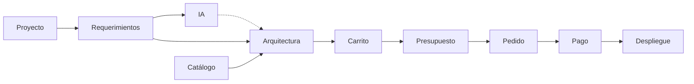

# Mapa funcional y módulos - Cloud_con_IA

En este documento vamos a dividir la aplicación en módulos. Cada módulo se encarga de una parte de la aplicación, por ejemplo el catálogo o los pedidos.

## 1. Tabla de módulos

| Módulo | Objetivo | Actores | Datos | Operaciones | Se relaciona con | Reglas y riesgos |
|---|---|---|---|---|---|---|
| Usuarios | Registro, login y roles | Todos | Usuario | Registrarse, iniciar sesión | Todos | Cada uno solo ve lo que le deja su rol |
| Catálogo | Mostrar los productos | Cliente, Administrador | Producto | Ver, buscar, crear y editar productos | Proveedores, Arquitecturas, Carrito | Un producto retirado no se puede contratar |
| Proveedores y regiones | Quién ofrece cada producto y dónde | Administrador | Proveedor, Región | Crear y editar | Catálogo | Un producto solo se contrata en sus regiones |
| Proyectos | Lo que quiere el cliente | Cliente | Proyecto | Crear y editar | Requerimientos, Arquitecturas | Cada cliente solo ve sus proyectos |
| Requerimientos | Pasar el proyecto a datos (ej: “ram >= 8”) | Cliente | Requerimiento | Añadir y borrar | Proyectos, Arquitecturas, IA | Los obligatorios se tienen que cumplir |
| Arquitecturas | Los productos que forman la solución | Cliente, Arquitecto | Arquitectura, ArquitecturaItem | Crear, modificar y validar | Proyectos, Catálogo, IA, Carrito | Laravel comprueba que cumple los requerimientos |
| IA | Recomendar arquitecturas | Cliente | Recomendación | Pedir recomendación | Requerimientos, Arquitecturas | Solo recomienda. Riesgo: que se invente datos |
| Carrito | Lo que se va a contratar | Cliente | Carrito | Añadir y quitar | Arquitecturas, Presupuestos | Separa pago mensual y pago único |
| Presupuestos | Precio final antes de pagar | Cliente | Presupuesto | Generar y aceptar | Carrito, Pedidos | Caduca y guarda los precios del momento |
| Pedidos | Lo que ha contratado el cliente | Cliente, Administrador | Pedido | Crear y consultar | Presupuestos, Pagos, Despliegues | Un pedido por presupuesto |
| Pagos | Pago simulado | Cliente | Pago | Pagar | Pedidos | Si falla, no se queda nada a medias |
| Despliegues | Poner en marcha lo contratado (simulado) | Cliente, Administrador | Despliegue | Iniciar y ver estado | Pedidos | Solo pedidos pagados |
| Auditoría | Guardar las acciones importantes | Auditor | Registro | Consultar registros | Todos | Los registros no se pueden borrar |

## 2. Diagrama

Este es el camino que sigue el cliente desde que crea un proyecto hasta que se despliega:

La flecha de puntos de la IA es porque la IA solo recomienda y la arquitectura la valida Laravel.
