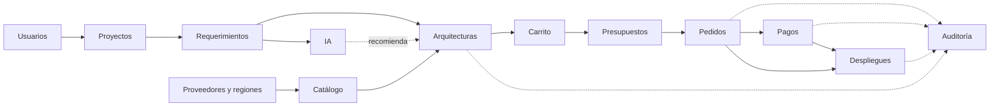

# Mapa funcional y módulos - Cloud_con_IA

En este documento vamos a dividir la aplicación en módulos. Cada módulo se encarga de una parte concreta, por ejemplo el catálogo o los pedidos. Para sacarlos nos hemos basado en el modelo de datos ([modelo-datos.md](modelo-datos.md)), en los actores y en los casos de uso.

Todavía no vamos a entrar en cómo se programa cada uno, solo en qué hace, quién lo usa, qué datos maneja y con qué otros módulos se relaciona.

## 1. Tabla de módulos

| Módulo | Objetivo | Actores | Datos principales | Operaciones | Relación con otros módulos | Reglas y riesgos |
|---|---|---|---|---|---|---|
| Usuarios | Gestionar quién entra en la plataforma y qué puede hacer | Todos | Usuario y rol | Registrarse, iniciar sesión, cambiar el rol de un usuario | Lo usan todos los demás para saber quién hace cada cosa | Cada usuario solo ve lo que le permite su rol. Riesgo: que alguien acceda a datos de otro cliente |
| Catálogo | Mostrar los productos Cloud que se pueden contratar | Cliente (consulta), Administrador (gestiona) | Producto y sus datos específicos | Buscar, filtrar, ver ficha, crear, editar y retirar productos | Proveedores y regiones, Arquitecturas, Carrito | Un producto retirado no se puede añadir, pero sigue en los pedidos antiguos |
| Proveedores y regiones | Saber quién ofrece cada producto y dónde | Administrador | Proveedor, región | Crear proveedores y regiones, indicar en qué regiones está cada producto | Catálogo, Requerimientos | Un producto solo se puede contratar en las regiones donde está disponible |
| Proyectos | Guardar lo que quiere conseguir el cliente | Cliente, Arquitecto (consulta) | Proyecto | Crear, editar y ver proyectos | Requerimientos, Arquitecturas, IA | Un cliente solo ve sus propios proyectos |
| Requerimientos | Pasar las necesidades del proyecto a condiciones concretas | Cliente | Requerimiento | Añadir, editar y borrar requerimientos (ej: “ram >= 8”) | Proyectos, Arquitecturas, IA | Los obligatorios se tienen que cumplir siempre. Riesgo: requerimientos que se contradicen |
| Arquitecturas | Montar la infraestructura que cumple el proyecto | Cliente, Arquitecto | Arquitectura, ArquitecturaItem | Crear una propuesta, añadir o quitar productos, validarla | Proyectos, Catálogo, IA, Carrito | Laravel comprueba que cumple los requerimientos y que los productos son compatibles |
| IA | Recomendar arquitecturas y alternativas más baratas | Cliente | RecomendaciónIA | Pedir una recomendación y aceptarla o rechazarla | Proyectos, Requerimientos, Arquitecturas | La IA solo recomienda, nunca guarda nada sin que Laravel lo valide. Riesgo: que se invente productos o precios |
| Carrito | Juntar lo que el cliente va a contratar | Cliente | Carrito, CarritoItem | Añadir, quitar y cambiar cantidades | Arquitecturas, Catálogo, Presupuestos | Separa lo que se paga al mes de lo que se paga una vez |
| Presupuestos | Calcular el precio final antes de pagar | Cliente | Presupuesto, PresupuestoLínea | Generar el presupuesto, consultarlo, aceptarlo | Carrito, Pedidos | Los precios se guardan en el momento y el presupuesto caduca. Riesgo: pagar un presupuesto caducado |
| Pedidos | Registrar lo que ha contratado el cliente | Cliente, Administrador | Pedido | Crear el pedido al aceptar el presupuesto, ver su estado | Presupuestos, Pagos, Despliegues | Solo se crea un pedido por presupuesto |
| Pagos | Simular el pago del pedido | Cliente | Pago | Pagar, ver si el pago ha ido bien o mal | Pedidos | El pago tiene que ser atómico: si falla a mitad, no se queda nada a medias |
| Despliegues | Simular la puesta en marcha de lo contratado | Cliente, Administrador | Despliegue, Recurso | Iniciar el despliegue, ver su estado y sus recursos, cancelarlo | Pedidos | Solo se despliegan pedidos pagados. No se crean máquinas reales |
| Auditoría | Guardar las acciones importantes para poder revisarlas | Auditor | RegistroAuditoría | Consultar y filtrar registros, sacar informes | Todos los módulos guardan aquí sus acciones importantes | Los registros no se pueden modificar ni borrar |

## 2. Diagrama del mapa funcional

En el siguiente diagrama se ve cómo se relacionan los módulos. El camino principal es el que sigue el cliente: crea un proyecto, define sus requerimientos, monta la arquitectura (con ayuda de la IA si quiere), la pasa al carrito, genera el presupuesto, paga el pedido y se despliega.

Las flechas de puntos hacia Auditoría significan que esos módulos guardan un registro de sus acciones importantes. La flecha de puntos de la IA significa que solo recomienda, y que es el módulo de Arquitecturas el que decide si se guarda o no.
